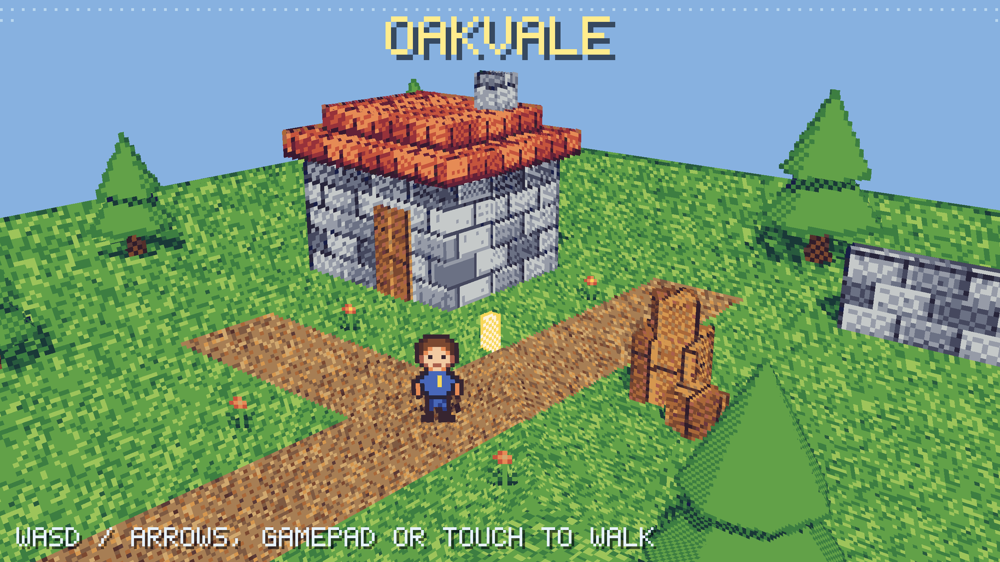
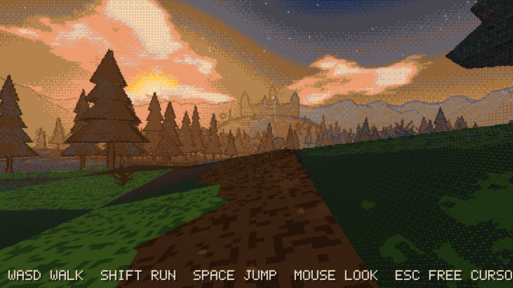
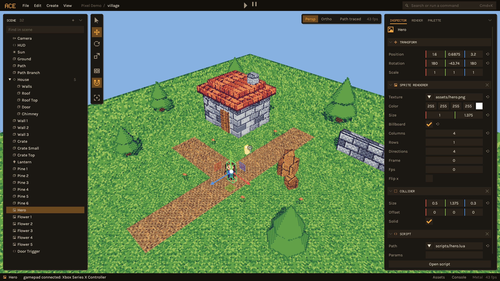
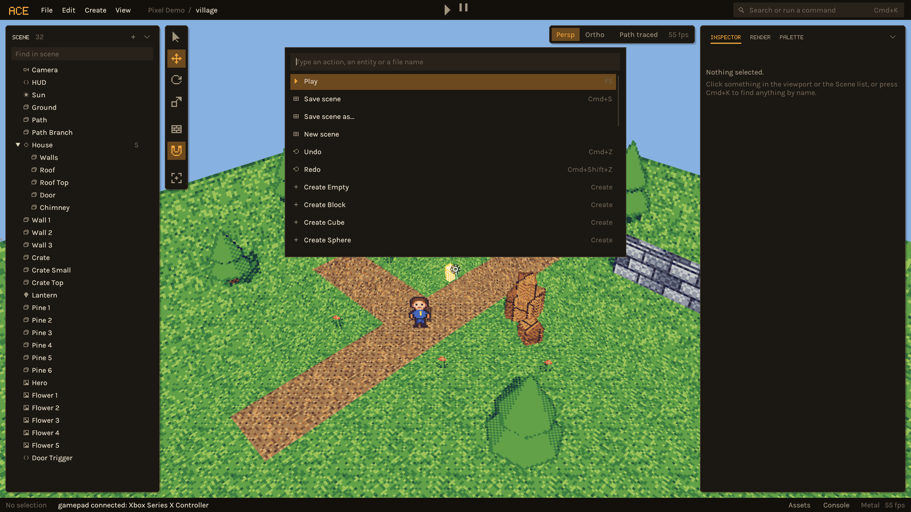

# AceEngine

A cross-platform game engine for stylized 2D and 3D games, with its own level
editor. It is built around one look first: **3D pixel art whose pixels belong
to the world, not the screen**, with palette-ramp shading, outlines and an
optional **path tracer** that keeps the same hard pixel grid.

Three hand-written graphics backends (**Metal, Vulkan, D3D12**) sit behind one
small RHI, with **Slang** as the only shader language. Gameplay is written in
**Lua**, and the engine itself in C++20.


<sub>`projects/pixel_demo`, `village` scene: perspective camera, world pixels, palette-ramp shading, billboard sprites, raster sun shadows.</sub>


<sub>`projects/forest`: a first-person open world (~115k triangles), path-traced world pixels, pixel clouds, stars and distance haze.</sub>

## What's inside

**Renderer** ([full write-up: docs/RENDERING.md](docs/RENDERING.md))

- **RHI** with handle-based resources, WebGPU-style bind groups with dynamic
  uniform offsets into one per-frame ring, and offscreen frames for
  screenshots and tests. Backends: Metal (SPIR-V to MSL through SPIRV-Cross),
  Vulkan, and D3D12 (DXIL, root signatures, descriptor tables).
- **World pixels** (after Dylan Ebert's
  [Texel Splatting](https://dylanebert.com/texel-splatting/)): the scene is
  captured into cube maps around a probe snapped to a world grid (plus an
  eye probe for disocclusions), and every captured texel is drawn as a small
  square in the world. Grid changes crossfade with a Bayer dissolve, and only
  the cube faces the camera can see are captured.
- **Path tracer** in a fullscreen fragment shader, so it needs no compute
  or ray-tracing hardware and runs on all three backends. It uses a
  binned-SAH BVH with front-to-back traversal, next-event estimation to the
  sun, point lights and emissive triangles, cosine-weighted bounces, and primary hits
  snapped to texel centres so the light lands on the pixel grid. A
  demodulated à-trous denoiser sharpens as samples accumulate.
- **Pixel-art pipeline**: texel-space lighting, toon bands, ordered dithering,
  palette snap (up to 64 colors), shading by hand-picked palette ramps,
  depth/normal outlines, integer upscaling, and directional sprite sheets.
- **Cross-backend determinism is measured**: Metal and Vulkan (MoltenVK)
  render pixel-identical images of the village and path-traced samples (the
  forest differs on 0.005% of pixels). D3D12 and Vulkan on the
  same NVIDIA GPU agree within 0.001–0.004%, after fixing three cases of
  compiler-dependent rounding (written up in RENDERING.md §11).

**Editor**: viewport-first, with gizmos, multi-select, undo, prefabs,
build-by-clicking blocks, a live palette editor, play-in-editor and a command
palette (see [Editor](#editor) below).

**Runtime**: an EnTT scene with reflected components (the editor UI is
generated from them), glTF meshes, Lua scripting with hot reload, a kinematic
character controller, raycasts and triggers, sound, gamepad and touch.

**Platforms**: verified on macOS (Metal, Vulkan via MoltenVK) and Windows 11
(D3D12, Vulkan); the Vulkan and D3D12 runs print zero validation-layer messages. The editor exports a
macOS app and an iOS app (simulator verified).

## Editor



The scene fills the window and the panels float over it. You can resize
them, collapse them, or hide them all with Cmd+\\.

- **Scene list** (left): search, type icons, lock toggles, rename in place.
  Many siblings with the same name (a forest of `Tree`s) fold into one row
  that selects them all.
- **Tool rail**: select, move, rotate, scale, build, snap (right-click for the
  step), frame selection.
- **Inspector** (right): colored X/Y/Z fields, a reset arrow on every value
  that differs from its default, collapsible component cards and a searchable
  *Add component* list. Its tabs also hold the scene's **Render** settings
  (each explained on hover; inactive ones are greyed out) and the
  **Palette** editor.
- **Drawer** (Cmd+J): an asset browser with pixel-exact thumbnails, folders
  and search, plus the console with level filters.
- **Status bar**: what is selected, the keys that apply right now, and the
  latest log line.



**Cmd+K** (Ctrl+K on Windows) opens the command palette, one fuzzy search
over every action, every entity and every file in the project. Type, then
Enter.

| Action | How |
| --- | --- |
| Orbit / pan / zoom | right-drag / middle-drag or Shift+right-drag / wheel |
| Select | click in the viewport or the Scene list; lights and cameras show as icons you can click. Shift+click adds to the selection (Cmd+click in the list) |
| Find anything | Cmd+K for everything, or the Scene list's search box for entities |
| Tools | Q select, W move, E rotate, R scale, B build; F frames the selection |
| Snap | the magnet in the tool rail; right-click it to set the step |
| Place things | drag a mesh or prefab from the drawer into the viewport: it lands on the surface under the cursor |
| Apply a texture or script | drag it onto an entity in the viewport, or onto a field in the Inspector |
| Build levels from blocks | B, pick a texture and a size, click any surface to add a block; Shift+click removes one |
| Create | the Create menu, the `+` on the Scene list, or Cmd+K "create ..." |
| Rename / re-parent | double-click a row (or F2) / drag a row onto another, or onto empty space |
| Lock | hover a row and click the lock: viewport clicks then pass through it (e.g. the ground) |
| Reset a value | the arrow beside it (appears only when it differs from the default) |
| Lights | a **Light** with `point` ticked is a lamp (up to 8 nearest the camera); the first light without `point` is the sun |
| Palette | **Palette** tab: one row per color ramp, darkest on the left; edits show live, **Save** writes the PNG |
| Gameplay | add a **Script**, then **New script** or **Open script** (VS Code if installed); saving while playing reloads it |
| Prefabs | right-click a row > **Save as Prefab**; drag or double-click the `.prefab.json` to place copies |
| Play / pause / stop | F5 / F6 (changes made while playing are undone on stop) |
| Undo, redo, save, duplicate, copy, paste, delete | Cmd+Z, Cmd+Shift+Z, Cmd+S, Cmd+D, Cmd+C, Cmd+V, Delete |

On Windows, use Ctrl wherever the table says Cmd.

## Build

**macOS:** Xcode command line tools and `brew install cmake ninja sdl3`.
For the Vulkan backend, also `brew install molten-vk vulkan-loader vulkan-headers vulkan-validationlayers`.

**Windows:** Visual Studio 2022 or newer (or its Build Tools) with "Desktop
development with C++" and "C++ CMake tools for Windows". For Vulkan, the Vulkan
SDK (`winget install KhronosGroup.VulkanSDK`). To see D3D12 debug messages
with `--validation`, add **Graphics Tools** under Settings > System > Optional
features. Run the commands below from a "Developer PowerShell for VS".

```sh
cmake -S . -B build -G Ninja
cmake --build build
ctest --test-dir build
```

The first configure downloads the pinned dependencies and the Slang compiler
into `build/` (Slang is reused from `~/.cache/ace/slang` if present).

## Run

```sh
build/bin/ace_editor projects/pixel_demo     # the editor, on the village sample
build/bin/ace_player projects/pixel_demo     # the game alone
build/bin/ace_player projects/forest         # first-person forest and castle, path traced
build/bin/ace_editor --new ~/games/my_game   # create and open a new project
```

Add `--backend metal|vulkan|d3d12` to choose the GPU API (default: Metal on
Apple platforms, D3D12 on Windows) and `--validation` for the API's debug
layer.

**As an app:** `tools/make_editor_app.sh` builds `build-export/AceEngine.app`
(macOS). `powershell -ExecutionPolicy Bypass -File tools\make_editor_windows.ps1`
builds `build-export\AceEngine\AceEngine.exe` and adds a Start menu entry
(Windows). Both reopen your last project and ask before closing with unsaved
changes. The app is a separate Release build: run the script again after
changing or pulling the code, or it keeps showing the old version.

## Making it look like pixel art

The demo's `scenes/village.scene.json` is the reference. There are two ways
to get pixels:

- **World pixels** (`worldPixels`, for perspective cameras): pixels stay
  attached to surfaces instead of sliding over them when the camera turns or
  moves. `probeResolution` sets their size (384 per cube face by default;
  lower is chunkier), and `probeCell` sets how far you walk before the pixel
  grid re-centres. Works with `pathTraced` too: the cube maps are path traced
  and settle within about a second while the camera is still.
- **Screen pixels** (`pixelArt` + `pixelHeight`): a low-resolution image
  scaled up. Rock steady with an orthographic camera (`pixelSnap`); with a
  perspective camera the pixels slide over surfaces.

Then, for both:

| What | Where |
| --- | --- |
| Pixel-art textures at one pixel size everywhere | MeshRenderer `worldTexels` + Render `texelsPerUnit` |
| Light and shadow that follow the texture's pixel grid | Render `texelLighting`, `toonBands`, `shadows` |
| Every on-screen color taken from one palette | Render `palette` (an image; up to 64 colors) and `dither` |
| Shading along hand-picked color ramps | Render `rampShading`, `rampShadowSteps`: each palette **row** is a ramp, darkest on the left |
| Characters and props as sprites in the 3D world | SpriteRenderer with `billboard`; `directions` = 4 or 8 for front/side/back views |
| Sky, sun, clouds, stars, haze | Render `skyTop`, `skyBottom`, `sunSize`, `sunGlow`, `cloud*`, `stars`, `fogColor`, `fogDensity` |

Draw textures and sprites from the same palette image, using each ramp's middle
colors so ramp shading can step both ways. Size sprites so one texel matches
the world: a 16x22 sprite at 16 texels per unit is 1.0 x 1.375.
`python3 tools/make_demo_art.py` regenerates the demo's art.

## Performance

Apple M1 Pro, 2560x1440 output (from RENDERING.md §12; the machine was
often under load, so compare these with each other rather than with other
engines):

| Configuration | Frame time |
| --- | --- |
| Screen pixels, raster | ~5 ms |
| World pixels, raster (village) | 9.1 ms Metal, 8.4 ms Vulkan |
| World pixels, path traced, still camera (village) | 16.5 ms, then cheaper as it settles |
| Forest, walking, raster world pixels | 15 ms |
| Forest, walking, path traced (shipped settings) | ~60 ms |

Walking while path tracing is the expensive case, since new probes start from
zero samples. It is the next item on the roadmap.

## Status and limits

Early, but usable on macOS and Windows. Not done yet: Windows and Android
export, compute shaders in the RHI, more than one frame in flight, GPU-local
static buffers, cascaded shadows, raster shadows for point lights, a
two-level BVH and a temporal denoiser, skeletal animation, and rigid-body
physics (collisions are kinematic for now). RENDERING.md §13 and HANDOFF.md
§6 list them in order.

## Testing

```sh
build/bin/ace_tests                 # unit tests: scenes, prefabs, BVH, raycasts, splat geometry, ...
tools/autotest.sh                   # the editor driven by injected mouse and keyboard input (107 steps),
                                    # on Metal and Vulkan (on Windows: tools/autotest.sh d3d12 vulkan)
python3 tools/measure_shimmer.py    # frame-to-frame pixel change, world vs screen pixels
```

Rendering changes are checked with `--screenshot` on every backend and
compared image to image; see HANDOFF.md §4.

## Projects and export

```
my_game/
  project.json            name, start scene, window size
  scenes/*.scene.json     entities + render settings
  scripts/*.lua           gameplay (docs/SCRIPTING.md)
  assets/...              .gltf/.glb meshes, .png/.jpg textures, .wav sounds
```

Meshes are `builtin:cube`, `builtin:sphere`, `builtin:plane`, `builtin:quad`
or a glTF path. Colors in scenes are sRGB. **File > Export** in the editor
builds a macOS app, an iOS Simulator app or an unsigned iOS device app, and
so do `tools/export_macos.sh` and `tools/export_ios.sh`.

## Documentation

| Document | For |
| --- | --- |
| [docs/RENDERING.md](docs/RENDERING.md) | how the renderer works: RHI and backends, world pixels, path tracer, measurements, limits |
| [docs/SCRIPTING.md](docs/SCRIPTING.md) | the Lua gameplay API |
| [docs/GLOSSARY.md](docs/GLOSSARY.md) | every technical term used in the docs, explained, grouped by topic |
| [docs/HANDOFF.md](docs/HANDOFF.md) | project state: decisions, what is verified, working rules, pitfalls, roadmap |

## Source layout

```
engine/rhi       GPU interface + Metal, Vulkan and D3D12 backends
engine/render    renderer: raster and path-traced scene passes, world pixels, present pass
engine/shaders   Slang shaders
engine/scene     entities, components, reflection, serialization
engine/script    Lua bindings
engine/assets    meshes and textures
engine/platform  window, input, timing (SDL3: windowing and input only, never rendering)
editor/          level editor (Dear ImGui, drawn through the RHI)
player/          game runtime executable
projects/        samples: pixel_demo (village), forest (first-person open world)
tests/           unit tests
tools/           export scripts, editor autotest, measurement and art scripts
```

Dependencies, all pinned in `cmake/Deps.cmake`: SDL3, GLM, EnTT, nlohmann/json,
stb, cgltf, Lua 5.4, SPIRV-Cross (Metal), Dear ImGui and ImGuizmo (editor), and
Slang (shader compiler). The editor's fonts, Karla and Cousine, ship with
Dear ImGui.

## How it was built

AceEngine was created with the help of Claude, Anthropic's AI assistant,
especially the graphics API backends (Metal, Vulkan and D3D12) and the
renderer around them. Every change is checked the same way, whoever wrote it:
it builds on every platform, runs with zero Vulkan and D3D12
validation-layer messages, passes the unit tests and the editor autotest,
and its screenshots are compared across backends (RENDERING.md §11 has the
numbers).

## License

AceEngine is released under the [MIT License](LICENSE). Dependencies keep
their own licenses (MIT, zlib, Apache-2.0, public domain); the editor fonts
are under the SIL Open Font License (Karla) and Apache-2.0 (Cousine).
